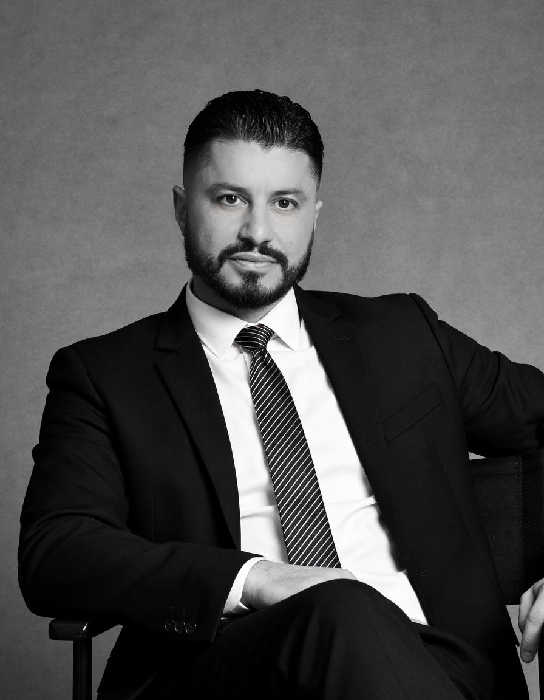

El abogado Vardan Daldumyan trabajó como abogado litigante interno para una compañía de seguros. Sabe cómo las aseguradoras evalúan los reclamos y usa ese conocimiento a su favor.

- Consulta gratis y confidencial
- No cobramos a menos que obtengamos una compensación para usted
- Trato directo con su abogado
- Atención en español

[Llame al 323-452-5222] [Envíenos un texto] [Evaluación gratis de su caso]

<!-- /HERO -->

## Casos que manejamos {: .sec-cards }

### Accidentes de auto
Choques en autopistas y calles, choques por alcance y conductores que se dan a la fuga en todo el condado de Los Ángeles. [Abogado de accidentes de auto](/es/abogado-accidentes-de-auto/)

### Accidentes de camión y vehículos comerciales
Camiones de carga, camionetas de reparto y vehículos de empresa. La compañía y su seguro comercial pueden ser responsables. [Más información](/es/abogado-accidentes-de-auto/)

### Accidentes de Uber y Lyft
En 2026 California redujo la cobertura contra conductores sin seguro que Uber y Lyft deben tener. Saber qué póliza aplica es más importante que nunca. [Más información](/es/abogado-accidentes-de-auto/)

### Lesiones graves y muerte por negligencia
Lesiones cerebrales, de columna y otras lesiones que cambian su vida, y reclamos de familias que perdieron a un ser querido. [Hable con un abogado](/es/contacto/)

### Accidentes de motocicleta
Las aseguradoras suelen culpar al motociclista. Respondemos con pruebas. [Más información](/es/abogado-accidentes-de-auto/)

### Lemon Law (autos defectuosos)
Si su auto nuevo o arrendado ha ido al taller una y otra vez por el mismo problema, el fabricante puede estar obligado a recomprarlo o reemplazarlo. El fabricante paga los honorarios de abogado cuando usted gana. Mercedes-Benz y todas las marcas. [Lemon Law de California](/es/lemon-law/)

## Por qué importa la experiencia del lado de las aseguradoras {: .sec-about }

Las compañías de seguros tienen ajustadores y abogados cuyo trabajo es pagarle lo menos posible. El abogado Daldumyan trabajó de ese lado. Por eso sabe:

- **Qué buscan los ajustadores** para reducir el valor de un reclamo
- **Por qué la primera oferta** casi nunca es la cantidad real
- **Cómo preparar un caso** que la aseguradora tome en serio

Manejamos casos antes de una demanda y en litigio.

[Llame al 323-452-5222] [Envíenos un texto]

## Qué pasa cuando nos llama {: .sec-steps }

1. **Evaluación gratis.** Llame, envíe un texto o mande el formulario. Hablamos por teléfono, por video o en persona.
2. **Una respuesta honesta.** Le decimos qué pensamos de su caso y qué opciones tiene. Sin compromiso.
3. **Nosotros nos encargamos.** Tratamos con las aseguradoras y reunimos las pruebas mientras usted se concentra en su tratamiento.
4. **Resolución.** Negociamos por el valor completo de su reclamo y, si hace falta, presentamos una demanda. No paga honorarios a menos que obtengamos una compensación.

## Lo que dicen nuestros clientes

Reseñas reales de Google (en inglés): [ver todas en Google](https://www.google.com/maps/search/?api=1&query=Prospect+Law+Group+600+W+Broadway+Suite+320+Glendale+CA+91204)

> "Amazing lawyer helped me settle a case that happened two years ago and not only kept me updated on everything about the case, but also fought to get the amount that I deserve so I would highly recommend him."
> **Humberto A.**, reseña de Google

> "My previous attorney wasn't getting any offers because liability was disputed. Vardan took over, flipped liability from 0% to 100%, and got me the full policy limit. Couldn't be happier with the result."
> **Hovik T.**, reseña de Google

<small>Los testimonios reflejan experiencias individuales. Los resultados anteriores no garantizan un resultado similar. Cada caso es diferente.</small>

## Preguntas frecuentes

### ¿Cuánto cuesta la consulta?
La consulta es gratis. En casos de accidentes, solo cobramos si obtenemos una compensación para usted. En casos de Lemon Law, la ley de California exige que el fabricante pague los honorarios de abogado cuando usted gana.

### ¿Necesito papeles o documentos de inmigración para hacer un reclamo?
No. En California, su estatus migratorio generalmente no le impide reclamar una compensación por sus lesiones, y no le preguntamos sobre su estatus.

### La aseguradora ya me hizo una oferta. ¿Debo aceptarla?
No antes de saber cuánto vale su reclamo. Una vez que firma, el caso termina aunque después necesite más tratamiento. Revisamos la oferta gratis.

### ¿Cuánto tiempo tengo para presentar una demanda?
En California, el plazo para la mayoría de las demandas por lesiones personales es de dos años desde el accidente. Si hay una agencia del gobierno involucrada, generalmente debe presentar un reclamo dentro de seis meses.

### ¿Y si tuve parte de la culpa?
Todavía puede reclamar. En California su compensación se reduce según su porcentaje de culpa, pero no se elimina.

### ¿Tengo que ir a su oficina?
No. Podemos atenderle por teléfono o por video. Nuestra oficina está en Glendale y atendemos todo el condado de Los Ángeles y el sur de California.

### ¿Hablan español?
Sí. Ofrecemos atención en español para su consulta y durante su caso.

## Contacto

600 W. Broadway, Ste. 320, Glendale, CA 91204 · [323-452-5222](tel:+13234525222) (llamadas y textos)

[English](/) · [Հայերեն](/hy/)

<small>Este sitio web es publicidad de abogados. La información de este sitio no es asesoría legal. Usar este sitio o contactarnos no crea una relación abogado-cliente.</small>
