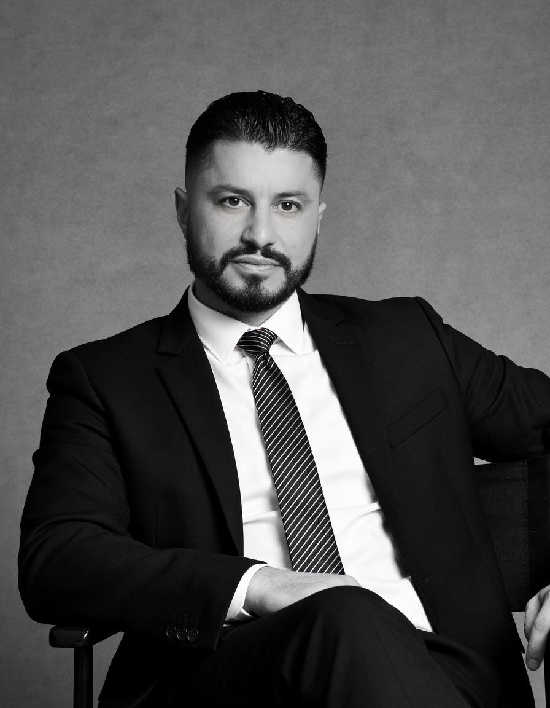

Փաստաբան Վարդան Դալդումյանը նախկինում աշխատել է որպես ապահովագրական ընկերության ներքին դատական փաստաբան։ Նա գիտի, թե ինչպես են ապահովագրողները գնահատում հայցերը, և այդ գիտելիքն այժմ օգտագործում է Ձեր օգտին։

- Անվճար և գաղտնի խորհրդատվություն
- Վճար միայն այն դեպքում, եթե մենք փոխհատուցում ստանանք
- Դուք անմիջապես աշխատում եք Ձեր փաստաբանի հետ
- Խոսում ենք հայերեն

[Զանգահարեք 323-452-5222] [Գրել SMS] [Անվճար գործի գնահատում]

<!-- /HERO -->

## Մեր գործունեության ոլորտները {: .sec-cards }

### Ավտովթարներ
Բախումներ մայրուղիներում և փողոցներում, հետևից հարվածներ և դեպքի վայրից հեռացած վարորդներ ամբողջ Լոս Անջելեսի շրջանում։ [Ավտովթարի փաստաբան](/hy/practice-areas/car-accidents/)

### Բեռնատարների և առևտրային մեքենաների վթարներ
Բեռնատարներ, առաքման մեքենաներ և ընկերությունների մեքենաներ։ Պատասխանատու կարող են լինել ընկերությունը և նրա առևտրային ապահովագրությունը։ [Բեռնատարի վթարներ](/hy/practice-areas/truck-accidents/)

### Uber և Lyft վթարներ
2026 թվականին Կալիֆորնիան կրճատեց չապահովագրված վարորդների դեմ ծածկույթը, որը Uber-ը և Lyft-ը պարտավոր են ունենալ։ Կարևոր է իմանալ, թե որ ապահովագրությունն է գործում։ [Uber և Lyft վթարներ](/hy/practice-areas/rideshare-accidents/)

### Ծանր վնասվածքներ և մահվան դեպքեր
Գլխուղեղի և ողնաշարի վնասվածքներ, ինչպես նաև հարազատին կորցրած ընտանիքների հայցեր։ [Մահվան դեպքերի հայցեր](/hy/practice-areas/wrongful-death/)

### Մոտոցիկլների վթարներ
Ապահովագրողները հաճախ մեղադրում են մոտոցիկլավարին։ Մենք պատասխանում ենք ապացույցներով։ [Մոտոցիկլի վթարներ](/hy/practice-areas/motorcycle-accidents/)

### Lemon Law (թերի մեքենաներ)
Եթե Ձեր նոր կամ վարձակալված մեքենան բազմիցս վերանորոգվել է նույն խնդրի համար, արտադրողը կարող է պարտավոր լինել հետ գնել կամ փոխարինել այն։ Հաղթելու դեպքում փաստաբանի վճարը վճարում է արտադրողը։ Mercedes-Benz և բոլոր այլ մակնիշներ։ [Lemon Law](/hy/practice-areas/lemon-law/)

## Ինչու է կարևոր ապահովագրական փորձը {: .sec-about }

Ապահովագրական ընկերությունները ունեն փորձառու փաստաբաններ և ճշգրտողներ, որոնց նպատակն է նվազեցնել Ձեր վճարը։ Փաստաբան Դալդումյանը աշխատել է այդ կողմում։ Նա գիտի՝

- **Ինչ են փնտրում ճշգրտողները**՝ հայցի արժեքը նվազեցնելու համար
- **Ինչու առաջին առաջարկը** հազվադեպ է իրական գումարը
- **Ինչպես պատրաստել գործ**, որը ապահովագրողը լուրջ է ընդունում

Մենք վարում ենք գործեր թե՛ մինչև դատական հայցը, թե՛ դատարանում։

[Զանգահարեք 323-452-5222] [Գրել SMS]

## Ինչ է լինում, երբ կապվում եք մեզ հետ {: .sec-steps }

1. **Անվճար գնահատում։** Զանգահարեք, գրեք կամ ուղարկեք ձևը։ Կխոսենք հեռախոսով, տեսազանգով կամ անձամբ՝ հայերենով։
2. **Անկեղծ պատասխան։** Կասենք, թե ինչ ենք մտածում Ձեր գործի մասին և ինչ տարբերակներ ունեք։ Առանց պարտավորության։
3. **Մենք ստանձնում ենք գործը։** Մենք ենք շփվում ապահովագրական ընկերությունների հետ և հավաքում ապացույցները, իսկ Դուք կենտրոնանում եք բուժման վրա։
4. **Լուծում։** Բանակցում ենք Ձեր հայցի լիարժեք արժեքի համար և անհրաժեշտության դեպքում դիմում դատարան։ Վճար՝ միայն փոխհատուցում ստանալու դեպքում։

## Մեր հաճախորդների կարծիքները

Google-ի իրական կարծիքներ (անգլերենով)՝ [տեսնել բոլորը Google-ում](https://www.google.com/maps/search/?api=1&query=Prospect+Law+Group+600+W+Broadway+Suite+320+Glendale+CA+91204)

> "Amazing lawyer helped me settle a case that happened two years ago and not only kept me updated on everything about the case, but also fought to get the amount that I deserve so I would highly recommend him."
> **Humberto A.**, Google

> "My previous attorney wasn't getting any offers because liability was disputed. Vardan took over, flipped liability from 0% to 100%, and got me the full policy limit. Couldn't be happier with the result."
> **Hovik T.**, Google

<small>Կարծիքներն արտացոլում են առանձին հաճախորդների փորձը։ Նախկին արդյունքները չեն երաշխավորում նմանատիպ արդյունք։ Յուրաքանչյուր գործ տարբեր է։</small>

## Հաճախ տրվող հարցեր

### Որքա՞ն արժե խորհրդատվությունը։
Խորհրդատվությունն անվճար է։ Ավտովթարի գործերում մենք վճար ենք ստանում միայն փոխհատուցում ստանալու դեպքում։ Lemon Law գործերում, հաղթելու դեպքում, փաստաբանի վճարը վճարում է արտադրողը։

### Ապահովագրական ընկերությունն արդեն առաջարկ է արել։ Ընդունե՞մ։
Մի՛ ստորագրեք, քանի դեռ չգիտեք, թե որքան արժե Ձեր հայցը։ Ստորագրելուց հետո գործը փակվում է, նույնիսկ եթե հետագայում լրացուցիչ բուժման կարիք ունենաք։ Առաջարկը կուսումնասիրենք անվճար։

### Որքա՞ն ժամանակ ունեմ հայց ներկայացնելու համար։
Կալիֆորնիայում անձնական վնասվածքի հայցերի մեծ մասի համար ժամկետը երկու տարի է վթարի օրվանից։ Եթե ներգրավված է պետական մարմին, պահանջը սովորաբար պետք է ներկայացվի վեց ամսվա ընթացքում։

### Պե՞տք է գամ գրասենյակ։
Ոչ։ Կարող ենք հանդիպել հեռախոսով կամ տեսազանգով։ Մեր գրասենյակը Գլենդեյլում է։

### Կարո՞ղ եմ ամբողջ գործը վարել հայերենով։
Այո։ Փաստաբան Դալդումյանը խոսում է հայերեն։

## Կապ

600 W. Broadway, Ste. 320, Glendale, CA 91204 · [323-452-5222](tel:+13234525222)

[English](/) · [Español](/es/)

<small>Այս կայքը փաստաբանական գովազդ է։ Այս կայքի տեղեկատվությունը իրավաբանական խորհուրդ չէ։ Կայքից օգտվելը կամ մեզ հետ կապվելը չի ստեղծում փաստաբան-հաճախորդ հարաբերություն։</small>
