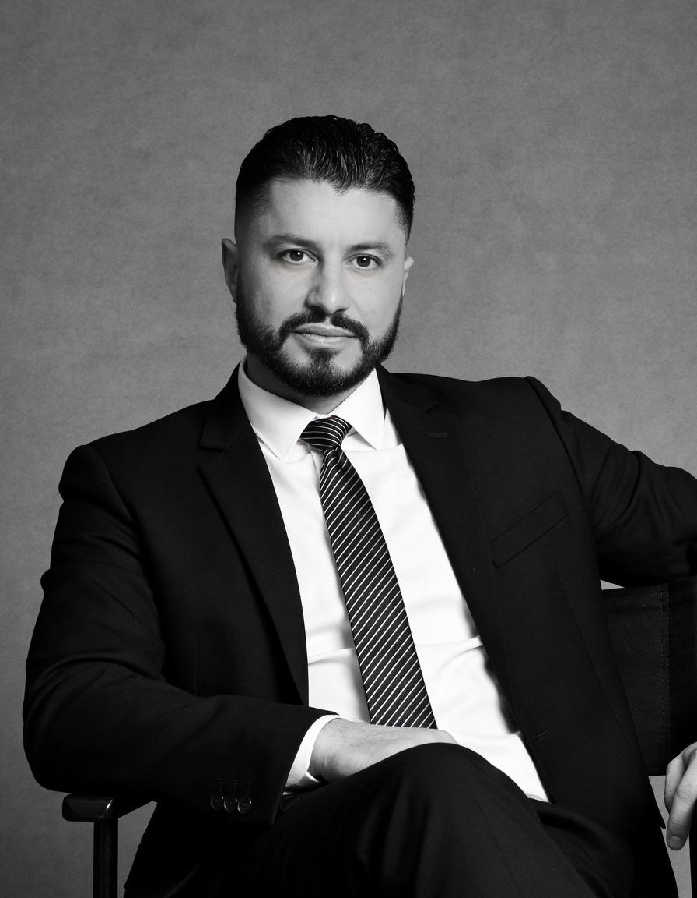

## Our Story

Prospect Law Group was founded in Glendale, California with a singular mission: to provide premium personal injury representation to individuals and families who have been harmed by negligence. Led by Vardan Daldumyan, Esq., our firm combines the aggressive litigation approach of a large firm with the personalized attention of a boutique practice.

We believe every client deserves an attorney who will fight as hard as they would for their own family, and that is exactly what we deliver. From initial consultation through settlement or trial, we prepare every case thoroughly, communicate clearly, and pursue full compensation for medical bills, lost income, and the pain our clients endure.

Our Mission

To fight relentlessly for injured clients throughout Los Angeles County, securing the maximum compensation they deserve while providing compassionate, accessible legal representation rooted in integrity and excellence.

## Our Values

- Integrity in every interaction
- Aggressive advocacy without compromise
- Accessibility and transparency
- Community commitment
- Excellence in legal practice
- Compassion for our clients

## Vardan Daldumyan {#lead-attorney}

{.headshot}

**Founder and Lead Attorney**

Lead Attorney Vardan Daldumyan combines extensive litigation experience with a client focused approach to help injury victims obtain the compensation they deserve. Having worked on both the defense and plaintiff sides of personal injury litigation, Vardan brings a unique perspective to every case and understands firsthand how insurance companies evaluate, defend, and resolve claims.

Before founding Prospect Law Group, Vardan handled a wide range of personal injury and civil litigation matters. His experience representing insurance companies provided valuable insight into claim valuation, negotiation tactics, and defense strategies. He now uses that knowledge to advocate for injured clients and pursue the maximum recovery available under the law.

Vardan is committed to providing personalized representation, maintaining open communication, and ensuring every client receives the attention and guidance they deserve throughout their case. He believes that every client should have direct access to their attorney and be kept informed every step of the way.

Vardan understands that an accident can leave individuals facing physical injuries, financial hardship, and uncertainty about the future. He takes pride in helping clients navigate the legal process with compassion, dedication, and strong advocacy. His goal is simple: to shoulder the legal burden so his clients can focus on their recovery while he fights to secure the best possible result on their behalf.

You pay nothing unless we successfully recover compensation on your behalf.

### Professional Memberships

* California State Bar
* Los Angeles County Bar Association
* Armenian Bar Association
